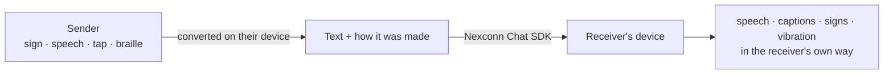

# AnyWay Chat

**No one should need help to say hello.**

AnyWay Chat lets blind, deaf, deaf-blind and non-speaking people chat, call and meet anyone, each in their own way. Everyone else just talks normally. AnyWay translates in between.

Built with the [Nexconn Chat SDK](https://docs.nexconn.ai) for the **Nexconn Build Challenge 2026** (Humanitarian & Social Good track).

---

## Why this exists

Most chat apps assume you can see the screen, hear a voice and type on a keyboard. Hundreds of millions of people can't do all three.

| | |
|---|---|
| **430 million** | people live with disabling hearing loss (WHO) |
| **70 million+** | deaf people use a sign language (World Federation of the Deaf) |
| **~97 million** | people can't rely on speech to be understood (Beukelman & Light, 2020) |
| **< 500** | certified sign language interpreters for India's ~18 million deaf people |

Today a blind teenager waits for a parent to type his messages. A deaf customer writes on paper at a shop counter. Human interpreters will never scale to meet this need. Technology can.

## How it works

Every person picks, once, how they send and how they receive. Every message travels as text through Nexconn, and is turned into the form each receiver can use on their own device.

| If you are | You send by | You understand by |
|---|---|---|
| **Blind** | speaking | hearing every reply, read aloud in a natural voice |
| **Deaf** | signing to the camera | seeing text and sign animations |
| **Non-speaking** | tapping ready phrases or typing | reading, or hearing it spoken |
| **Deaf-blind** | typing in braille | feeling vibration patterns and braille |
| **Anyone else** | typing or talking normally | reading or listening normally |

The hearing, sighted person never has to learn sign language or braille. They just talk.



## Nexconn SDK usage

| Nexconn feature | Used for |
|---|---|
| `NCEngine.initialize` / `connect` | Signing each demo user in to the Singapore data centre |
| `DirectChannel.sendMessage` + `SendTextMessageParams` | Sending messages, with the original mode stored in `extra` |
| `MessageHandler.onMessageReceived` | Receiving messages live |
| `BaseChannel.createMessagesQuery` | Loading chat history |
| Platform Chat API `/v4/auth/access-token/issue` | Issuing user tokens from the server, signed with the App Secret |

The App Secret is only ever used on the server. The browser receives short-lived user tokens, never the secret.

## Tech stack

- **React 19 + TypeScript + Vite** web app, works on phones and laptops
- **Nexconn Chat SDK** (`@nexconn/chat`, `@nexconn/engine`) for messaging
- **Atkinson Hyperlegible** typeface, designed for low-vision readers
- Planned: browser Speech Recognition and Speech Synthesis, MediaPipe hand tracking for signs, the Vibration API, and the Nexconn Call SDK

## Run it locally

You need Node.js 20+ and a free [Nexconn account](https://console.nexconn.ai).

```bash
git clone https://github.com/sakthilildih/AnyWay-Chat.git
cd AnyWay-Chat
npm install
cp .env.example .env.local   # then add your App Key and App Secret
npm run dev
```

Open http://localhost:5173.

### Try a real conversation

Open two browser windows side by side:

1. **Window 1:** http://localhost:5173/chat/priya?mode=standard — you are **Amma**, who talks and types normally.
2. **Window 2:** http://localhost:5173/chat/amma?mode=deaf — you are **Priya**, who is deaf and signs.

Send a message from Amma. Priya sees it with a *Watch in ISL* option. Press **Send** on Priya's sign panel, and Amma sees the reply labelled *Signed in ISL*.

Demo people: Arjun (blind), Priya (deaf), Meera (non-speaking), Kavin (deaf-blind), Amma (talks and types).

## Project structure

```
src/
  landing.html        Landing page
  screens/            Welcome, Home (chat list), Chat, calls, Go mode, Profile
  nexconn.ts          Nexconn Chat SDK connection, send, receive, history
  useChat.ts          React hooks for the connection and live threads
  state.tsx           Profiles, demo people
vite.config.ts        Dev server, including the /api/token service that signs Nexconn requests
.claude/skills/       Official Nexconn agent skill used while building
```

## Accessibility principles

- Every screen adapts to the person using it, not the other way round.
- Large touch targets, real buttons and labels, visible keyboard focus.
- High-contrast, larger text for blind and deaf-blind profiles.
- Motion is minimal and respects *reduce motion* settings.
- Sign recognition always shows what it understood and asks before sending.

## Roadmap

1. Voice input and read-aloud for blind users
2. Indian Sign Language recognition (fingerspelling + ~30 common signs) and sign clips
3. Voice and video calls with live translation
4. Go mode for face-to-face conversations
5. Deaf-blind vibration and braille
6. More sign languages as plug-in packs, built with deaf communities

---

Made in India for everyone who has ever had to ask for help to say hello.
