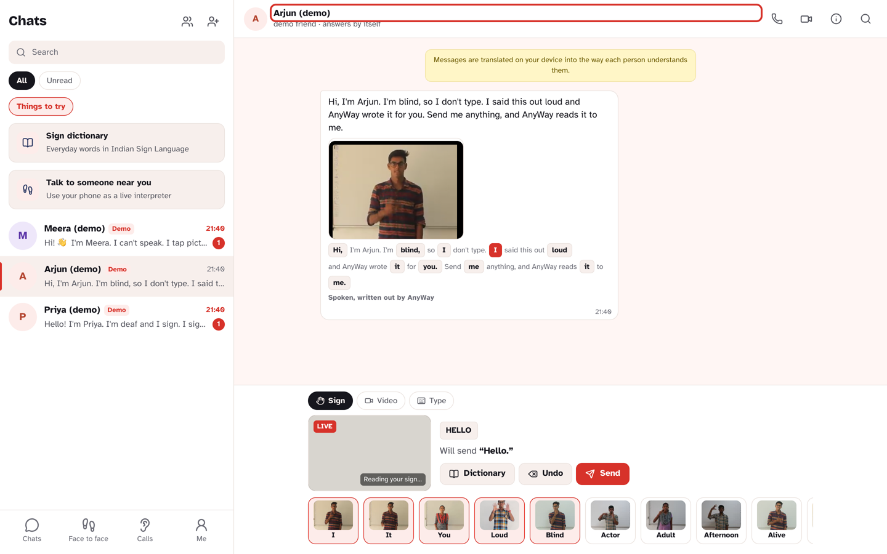
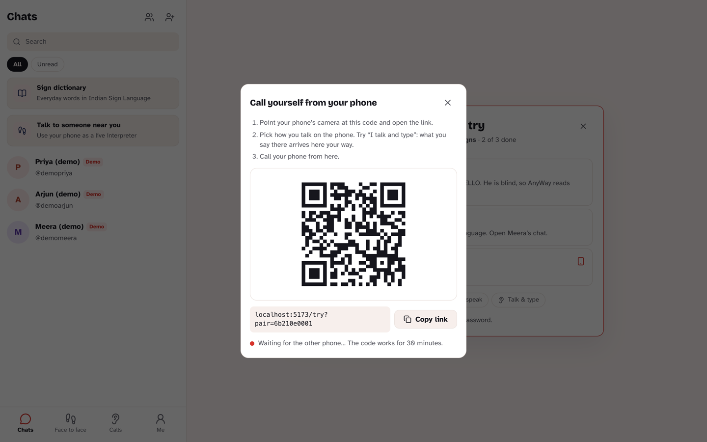
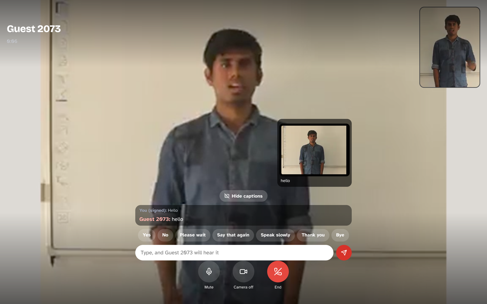
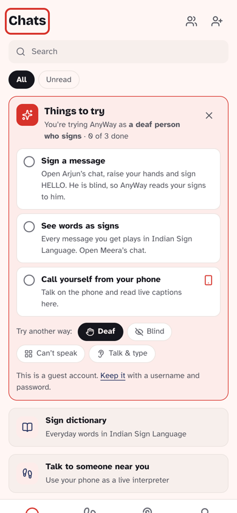
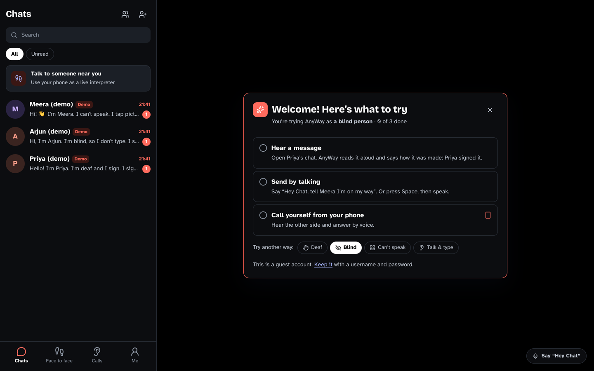
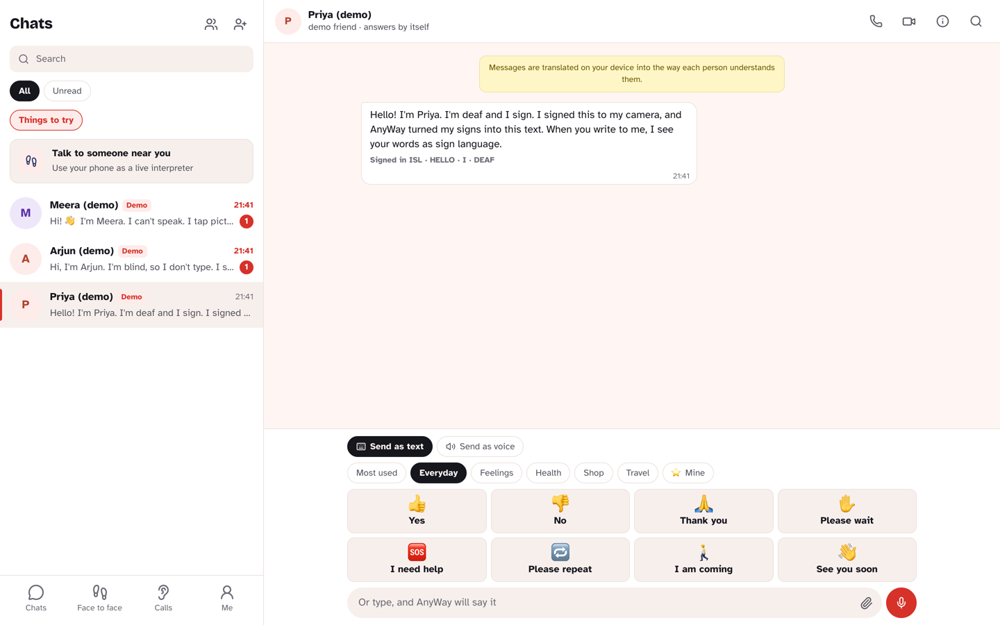
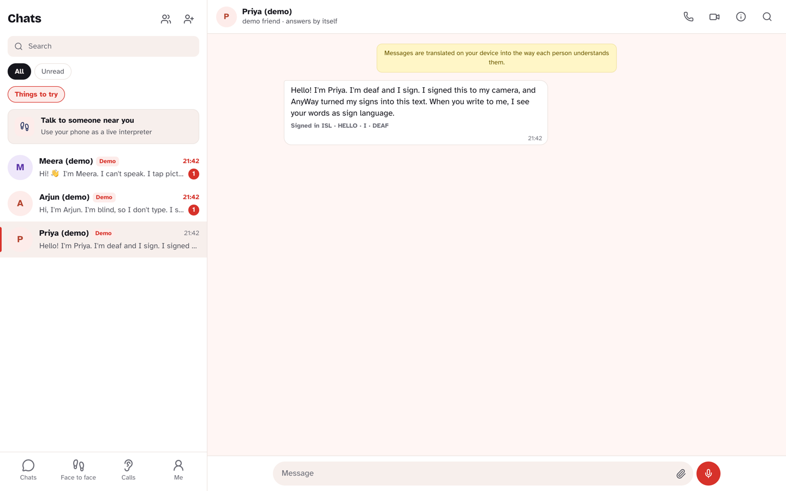
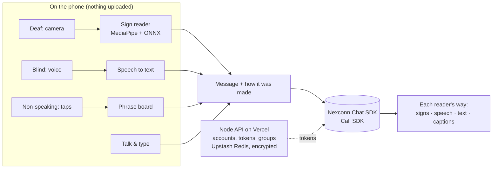

<div align="center">


# AnyWay Chat

**One chat where deaf, blind and non-speaking people talk with anyone, each in their own way.**

A deaf person signs to the camera and their friend reads it. A blind person speaks and hears every reply.
A person who can't speak taps pictures and AnyWay says it out loud. The other person just chats normally.

[](https://github.com/sakthilildih/AnyWay-Chat/actions/workflows/ci.yml)


[](LICENSE)

[**Live app**](https://anywaychat.vercel.app) ·
[**Try it now, no sign-up**](https://anywaychat.vercel.app/try) ·
[Usage dashboard](https://anywaychat.vercel.app/admin)

</div>

<br>



<p align="center"><sub>A deaf user signs HELLO to the laptop camera; AnyWay reads it on the device and Arjun, who is blind, will hear it. Every screenshot here is the real app.</sub></p>

| | |
| --- | --- |
| Live app | https://anywaychat.vercel.app |
| Judge it in 2 minutes | https://anywaychat.vercel.app/try (one tap, no sign-up) |
| Real usage | https://anywaychat.vercel.app/admin (numbers only, no personal data; guests and demo friends counted apart) |
| Code | https://github.com/sakthilildih/AnyWay-Chat |
| Nexconn App Key | `qf3d5gbjqvm4h` (public by design; the App Secret stays on the server) |
| Built for | Nexconn Build Challenge 2026 · Humanitarian & Social Good |

## Contents

- [Try it in 2 minutes](#try-it-in-2-minutes)
- [The problem](#the-problem)
- [Who it's for](#whos-it-for)
- [What's new here](#whats-new-here)
- [Features](#features)
- [Built on Nexconn](#built-on-nexconn)
- [Architecture](#architecture)
- [Privacy and security](#privacy-and-security)
- [Tests](#tests)
- [Run locally](#run-locally)
- [Limitations](#limitations)
- [Credits](#credits)
- [Licenses](#licenses)

## Try it in 2 minutes

No sign-up, no second person needed.

1. Open **[anywaychat.vercel.app/try](https://anywaychat.vercel.app/try)** and pick a way of talking: **I'm deaf**, **I'm blind**, **I can't speak** or **I talk and type**. One tap makes a guest account.
2. Three demo friends are already waiting, each answering in their own way: **Priya** is deaf and signs, **Arjun** is blind and talks, **Meera** can't speak and taps.
3. A **"Things to try"** card shows three steps for your way of talking, for example:
   - **Deaf:** open Arjun's chat, raise your hands and sign HELLO. AnyWay reads your sign on the laptop and Arjun hears it.
   - **Blind:** say *"Hey Chat, read my messages"*, then *"Hey Chat, tell Meera I'm on my way"*.
   - **Can't speak:** tap a picture phrase; AnyWay says it aloud and sends it.
4. **Call yourself from your phone.** Scan the QR code with your phone, pick a way of talking there, and press **Video call** on the laptop. Talk on one screen and watch live captions, signs and translations arrive on the other.
5. Switch to another way of talking any time from the card. Like it? **Keep** the guest account with a username and password.

| Call yourself from your phone | Live captions on the call | On a phone |
| --- | --- | --- |
|  |  |  |

## The problem

Chat apps assume everyone can see, hear, speak and type.

- **430 million** people live with disabling hearing loss ([WHO](https://www.who.int/news-room/fact-sheets/detail/deafness-and-hearing-loss)); **70 million+** deaf people use a sign language.
- **2.2 billion** people have a vision impairment ([WHO](https://www.who.int/news-room/fact-sheets/detail/blindness-and-visual-impairment)).
- **It grows with age.** Over 25% of people over 60 have disabling hearing loss, and most people with vision impairment are over 50 (WHO: [hearing](https://www.who.int/news-room/fact-sheets/detail/deafness-and-hearing-loss), [vision](https://www.who.int/news-room/fact-sheets/detail/blindness-and-visual-impairment)). India has **149 million** people over 60, and will have **347 million** by 2050 ([UNFPA India Ageing Report 2023](https://india.unfpa.org/en/news/india-ageing-elderly-make-20-population-2050-unfpa-report)).
- **97 million** people can't rely on speech alone and could use picture and voice aids, AAC ([Beukelman & Light, via ASHA](https://www.asha.org/Practice-Portal/Professional-Issues/Augmentative-and-Alternative-Communication/)).
- India has about **250 certified sign language interpreters for about 18 million deaf people** ([GSMA](https://www.gsma.com/mobilefordevelopment/blog/making-sign-language-interpretation-accessible-for-all-through-mobile-assistive-technology/), an older estimate).
- India's Supreme Court held that digital accessibility is a fundamental right, binding on private companies too ([Rajive Raturi v. Union of India, 2024](https://api.sci.gov.in/supremecourt/2005/9321/9321_2005_1_1503_56986_Judgement_08-Nov-2024.pdf); [Pragya Prasun v. Union of India, 2025](https://www.scconline.com/blog/post/2025/05/15/supreme-court-digital-inclusion-kyc-accessiblity/)).

So today a blind teenager waits for a parent to read his messages, a deaf customer writes on paper at the counter, and a grandmother whose eyes and ears are fading stops reading the family group.

## Who it's for

AnyWay translates **between** ways of communicating, inside one conversation:

| You are | You send by | You receive as |
| --- | --- | --- |
| **Deaf** | Signing to the camera (Indian Sign Language, read on the device), typing, picking signs, video messages | Text, plus every message played as ISL sign videos; voice notes written out; screen flashes and vibration |
| **Blind** | Talking: "Hey Chat, tell Priya I'm on my way" works on every screen | Every message read aloud, with who sent it and how ("Priya signed…"), photos described |
| **Non-speaking** | Tapping a picture phrase board (AAC), typing, or sending your words as a voice message | Text, read aloud if you like |
| **Talk & type** | Typing or talking, as in any chat | Messages labelled with how they were made ("Signed in ISL · HELLO · HOW ARE YOU") |

Every message is also **translated** into the reader's language (11 Indian languages), with the original underneath.

It works the same for **older people losing their sight or hearing**, with nothing new to learn: text up to *Huge* and high contrast in every mode, every message read aloud in blind mode, and live captions on calls.

| Blind: dark, spoken, "Hey Chat" | Can't speak: tap to talk | Talk & type: see how Priya signed |
| --- | --- | --- |
|  |  |  |

## What's new here

- **One conversation, every way of talking.** Each message carries *how it was made* (signed, spoken, tapped, typed) through Nexconn, so every reader gets it in their own form: signs, speech, text or captions.
- **An Indian Sign Language reader that runs on the phone.** MediaPipe hand and body tracking, then our own sign model (1D convolution + transformer, trained on all 4,257 clips of AI4Bharat's INCLUDE dataset with laptop and phone camera simulation). **97.8%** on held-out signs seen through a laptop camera, **97.9%** through a phone; in a real-browser test on 44 chat words, 84–89% on a laptop and 93–96% on a phone. When it isn't sure it asks *"Did you sign…?"* instead of guessing.
- **It learns your signs.** In the Sign lab you sign a word a few times; your examples stay on your device and are used when the model is unsure.
- **Live call captions both ways.** Speech becomes captions (and signs) for a deaf person; a deaf person's signs on camera become captions that are read aloud on the other side; non-speaking people answer with spoken quick taps; captions are translated between languages.
- **"Hey Chat" for blind users** on every screen: messages, calls, groups, contacts, settings, by voice.
- **Face to face:** one phone between two people interprets both ways; the other person needs no app.

## Features

- **Chat** (direct and group): text, photos, files, voice notes, video messages, replies, edits, delete for everyone, reactions, read receipts, typing, online status, search, block and report.
- **Voice and video calls** with live captions, signs and translation; weak-connection warning; "… is calling you" push notifications even when the app is closed.
- **Try it now:** a guest account in one tap with three demo friends, things to try for each way of talking, and a QR code to call yourself from your phone. Guests can keep their account later.
- **Other on-device AI:** voice notes written out (Whisper), photo descriptions (Florence-2) and an optional natural voice (Kokoro), each in a background worker so the app never freezes.
- **Accessibility for everyone:** text size, high contrast, light and dark, screen reader labels and focus, vibration patterns, flash alerts, installable app (PWA).

## Built on Nexconn

| Nexconn | Where |
| --- | --- |
| **Chat SDK** `NCEngine.initialize` / `connect` | One connection per signed-in person ([src/nexconn.ts](src/nexconn.ts)) |
| `DirectChannel` / `GroupChannel` `sendMessage`, `sendMediaMessage` | Text, photos, files, HD voice notes, video messages |
| Message `extra` | How a message was made (signed, spoken, tapped) and the signs used, so each reader gets it their own way |
| Reference messages, `updateMessage`, `deleteMessageForAll`, message metadata | Replies, edits, delete for everyone, reactions |
| Read receipts, typing status, `userModule.subscribeEvent` | Ticks, "typing…", online dots |
| Custom non-stored message type `anyway:caption` | Live call captions, signs and translations between the two screens ([src/components/CallCaptions.tsx](src/components/CallCaptions.tsx)) |
| `createChannelsQuery` / `createMessagesQuery` | Chat list with unread counts, history |
| **Call SDK** `NCCallEngine` | 1-to-1 voice and video calls ([src/calls.ts](src/calls.ts)) |
| **Platform Chat API** | Access tokens (App Secret stays on the server), groups, blocklist, server-sent messages for the demo friends ([server/api.ts](server/api.ts)) |

## Architecture



## Privacy and security

- Sign reading, speech to text for voice notes, photo descriptions and the natural voice all run **on the device**. Camera and microphone data is never uploaded.
- With `DATA_KEY` set, everything the server stores is **encrypted at rest** (AES-256-GCM). Passwords are scrypt hashes; logins are stored only as SHA-256 hashes, so a copy of the database can't be used to sign in.
- Every change to stored data runs under a lock, so a whole class signing up at once can't overwrite each other.
- Guest accounts are limited per network address and removed after 14 days unless kept. The public dashboard shows numbers only, and counts guests and demo friends apart from real sign-ups.

## Tests

92 automated tests run on every push ([CI workflow](.github/workflows/ci.yml)), together with the type check, lint and build.

```bash
npm test
```

| File | What it checks |
| --- | --- |
| [tests/api/auth.test.ts](tests/api/auth.test.ts) | Sign-up rules, login, logout, hashed passwords and logins, 10 logins per person, settings that follow you |
| [tests/api/guest.test.ts](tests/api/guest.test.ts) | One-tap guests for each way of talking, demo friends, no password login, the per-address limit, 14-day clean-up, dashboard counts |
| [tests/api/pair.test.ts](tests/api/pair.test.ts) | "Call yourself from your phone" codes: joining, own code, owner-only status, expiry |
| [tests/api/keep.test.ts](tests/api/keep.test.ts) | Keeping a guest account: new username, contacts, nicknames, pairing codes and login all follow |
| [tests/voiceIntents.test.ts](tests/voiceIntents.test.ts) | "Hey Chat" commands, filler words, contractions, misheard words |
| [tests/sign.test.ts](tests/sign.test.ts) | Sign reader guesses, "Did you sign…?", learning your signs, framing tips |
| [tests/messages.test.ts](tests/messages.test.ts) | "Signed in ISL" labels, reading long text sentence by sentence, turning messages into sign videos |
| [tests/demo.test.ts](tests/demo.test.ts) | Demo friends' replies, username rules, every "Things to try" step goes somewhere real |

The API tests start the real server code on a temporary database. Separately, an end-to-end run in real Chrome (laptop and phone as two sessions, the camera playing an INCLUDE clip of HELLO) checks the whole judge path: one tap in, the sign reader reading HELLO, QR pairing, a video call connecting on both screens, blind and non-speaking modes, and keeping a guest account.

## Run locally

Needs Node 20+ and a Nexconn app (free plan).

```bash
git clone https://github.com/sakthilildih/AnyWay-Chat.git
cd AnyWay-Chat
npm install
cp .env.example .env.local   # add your Nexconn App Key and App Secret
npm run dev
```

Open http://localhost:5173. Accounts are saved in `data/db.json` locally, or in Upstash Redis when `KV_REST_API_URL` / `KV_REST_API_TOKEN` are set (Vercel).

| Setting | What it does |
| --- | --- |
| `VITE_NEXCONN_APP_KEY`, `NEXCONN_APP_SECRET` | Nexconn app (the secret stays on the server) |
| `KV_REST_API_URL`, `KV_REST_API_TOKEN` | Upstash Redis storage (added by Vercel) |
| `DATA_KEY` | Encrypts stored data. Keep it safe: without it, stored data can't be read |
| `ADMIN_KEY` | Unlocks user management on `/admin` (locked on the live site without it) |
| `VAPID_PUBLIC_KEY`, `VAPID_PRIVATE_KEY` | Push notifications |

## Limitations

- The sign reader knows the everyday words of the INCLUDE dataset, one sign at a time; it does not read full ISL grammar or fingerspelling yet.
- Demo friends can't take calls; use **Call yourself from your phone** to try calls alone.
- Hey Chat uses the browser's speech recognition, which works best in Chrome and Edge.

## Credits

Built for the Nexconn Build Challenge 2026, starting Nov 15, 2026. ISL sign videos and training data: the INCLUDE dataset by AI4Bharat (CC BY 4.0); the signer in the screenshots is from INCLUDE.

Made in India. Built for everyone.

## Licenses

AnyWay Chat's code is released under the [MIT License](LICENSE).

It builds on open data, models and libraries, each under its own license:

| Part | Used for | License |
| --- | --- | --- |
| INCLUDE dataset (AI4Bharat) | Sign model training data and ISL sign videos | CC BY 4.0 |
| MediaPipe Hand and Pose Landmarker (Google) | Hand and body tracking on the device | Apache 2.0 |
| ONNX Runtime Web (Microsoft) | Running the sign model in the browser | MIT |
| Whisper (OpenAI), via Transformers.js | Voice notes written out | MIT (model), Apache 2.0 (Transformers.js) |
| Florence-2 (Microsoft) | Photo descriptions | MIT |
| Kokoro (hexgrad), via kokoro-js | Optional natural voice | Apache 2.0 |
| React, React Router, Vite, Lucide | The app | MIT / ISC |
| qrcode-generator | QR codes | MIT |
| Nexconn Chat SDK and Call SDK | Messaging and calls | Nexconn's terms of service |

